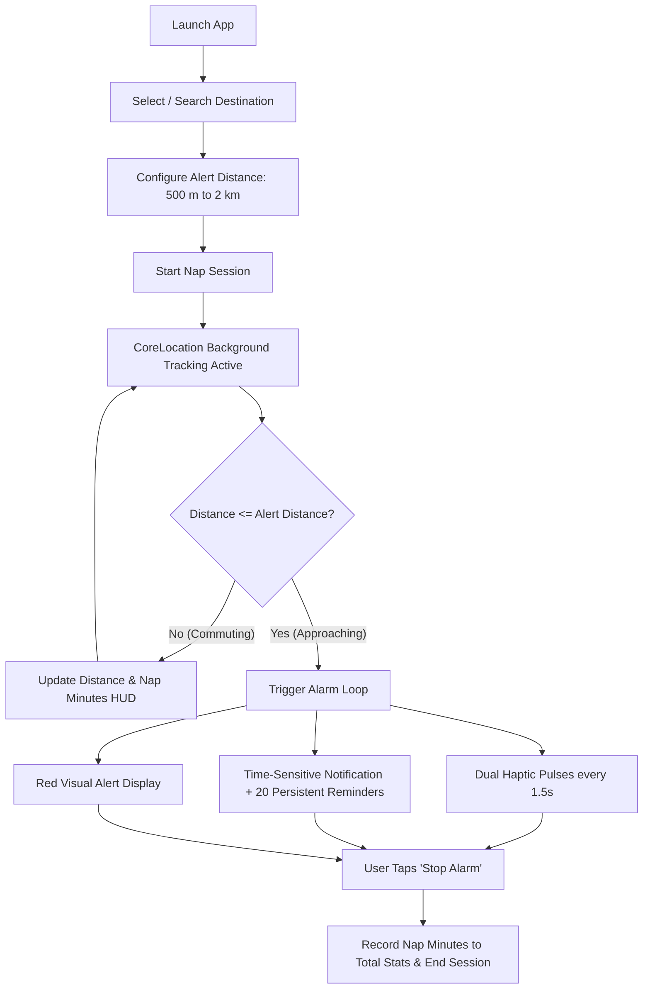

# Orio (watchOS) 🚊😴

> **Smart, location-aware transit nap alarm for Apple Watch.** Never miss your stop again.

[](https://developer.apple.com/watchos/)
[](https://swift.org/)
[](https://developer.apple.com/xcode/)
[](https://developer.apple.com/documentation/watchkit)
[](LICENSE)

---

## 📖 Overview

**Orio** is a standalone watchOS application designed for commuters who want to rest or nap peacefully on trains, subways, and buses without the fear of oversleeping and missing their station.

Traditional time-based alarms fall short on public transit because of unpredictable delays, signal stops, and timetable changes. Orio uses **real-time GPS geofencing and proximity tracking directly on your Apple Watch**, triggering escalating haptic patterns and persistent time-sensitive alerts the moment you approach your destination.

---

## ✨ Key Features

- ⌚ **100% Standalone Watch App**: Built with `WKWatchOnly: true`. Operates independently on your Apple Watch—no companion iPhone app required.
- 📍 **Proximity-Based Geofencing**: Alerts you based on physical distance to your station, not elapsed time.
- 🎚️ **Customizable Alert Distances**: Choose when to be woken up:
  - `500 m` (compact subway/bus stops)
  - `800 m` (approx. 1–2 minutes before arrival)
  - `1,000 m` (1 km)
  - `1,500 m` (1.5 km)
  - `2,000 m` (2 km for high-speed transit)
- 🚊 **Transport Modes**: Tailor your trip with dedicated modes:
  - 🚆 **Train** (`tram.fill`)
  - 🚇 **Subway** (`tram.tunnel.fill`)
  - 🚌 **Bus** (`bus.fill`)
- 🔔 **Multi-Stage Wakeup System**:
  - **Wrist-Down Alarm**: A smart-alarm `WKExtendedRuntimeSession` is armed when the trip starts (and re-armed whenever Orio comes back to the foreground). On arrival it plays repeating alarm haptics with the system alarm UI even while the wrist is down. watchOS limits each session to 30 minutes; after that, the notifications below are the fallback until you open Orio again.
  - **Repeating Dual Haptics**: While Orio is on screen, alternates `.notification` and `.failure` haptic taps every 1.5 seconds.
  - **Immediate Time-Sensitive Notification**: Uses the Time Sensitive Notifications entitlement and `interruptionLevel = .timeSensitive`, so alarms break through Focus modes (including Sleep) that allow time-sensitive notifications.
  - **Interactive Notification Action**: Dismiss the alarm with an actionable "Stop Alarm" button directly on the watch notification lock screen.
  - **Persistent Escalation Queue**: Pre-schedules 20 follow-up alert notifications spaced 10 seconds apart to prevent falling back asleep.
  - **High-Contrast Visual Warning**: Active display turns deep red with a prominent "WAKE UP" banner.
- 🔍 **Station & Location Search**: Integrated with Apple MapKit (`MKLocalSearch`) with 300ms debounce for instant search across train stations, transit hubs, and custom addresses.
- ⚡ **Smart Station Suggestions**:
  - **Nearby Stations**: Automatically calculates geodesic distances to major transit stations and displays the closest stops.
  - **Favorites & Most Used**: Star any station with the star button, a swipe on any row, or from trip setup for instant 1-tap starts.
  - **Recent History**: Remembers your recent stops with automatic LRU eviction; swipe left on a row to remove it.
- 🗺️ **Interactive Map Integration**:
  - **Pre-trip Map Preview**: Visualizes your destination pin alongside your current location with custom zoom controls and safe boundary clamping.
  - **Live Dynamic Snapshot**: Background `MKMapSnapshotter` renders an ambient route overview on the active nap HUD.
- ⏱️ **Commute & Nap Analytics**:
  - Live elapsed nap duration counter during active sessions.
  - Cumulative lifetime nap time counter (`totalNapMinutes`) tracked on the home screen with hold-to-reset support.
- 🛠️ **Developer Friendly**: Includes a built-in `#if DEBUG` **Demo Alert** button to test the haptic and alarm pipeline without leaving your desk.

---

## 🏗️ Architecture & Codebase Structure

The project is written in modern **SwiftUI** and conforms to Apple's latest watchOS conventions:

```
orio/
├── project.yml                     # XcodeGen project specification (source of truth)
├── Orio.xcodeproj                  # Generated Xcode project
├── NapsafeWatch.xcodeproj          # Generated alias kept only for the Xcode Cloud workflow
├── scripts/generate-project.sh     # Regenerates both projects from project.yml
├── Design/icon-sources/            # Original app icon artwork (not bundled)
├── Resources/
│   ├── Info.plist                  # Background modes (location, smart alarm) & descriptions
│   ├── Orio.entitlements           # Time Sensitive Notifications entitlement
│   ├── PrivacyInfo.xcprivacy       # Privacy manifest
│   └── Assets.xcassets             # App icons & color assets
└── Sources/
    ├── OrioApp.swift               # App entry point, service wiring & session restore
    ├── Models/
    │   ├── Destination.swift       # Destination entity, stable IDs & coordinate Codable support
    │   └── Session.swift           # NapSession model & TransportMode enum
    ├── Logic/
    │   ├── LocationFixFilter.swift # Accuracy/age filtering of GPS fixes
    │   └── ProximityEvaluator.swift# Arrival trigger rules & adaptive location precision
    ├── Services/
    │   ├── AlarmRuntimeController.swift # Smart-alarm extended runtime session (wrist-down alarm)
    │   ├── DestinationStore.swift  # Persistence (UserDefaults), Favorites & Station catalog
    │   ├── LocationManager.swift   # CoreLocation wrapper, background tracking & distance calculation
    │   ├── SessionManager.swift    # Session lifecycle, repeating haptics & notification scheduling
    │   └── SessionStore.swift      # Persists the active trip across relaunches
    ├── Utilities/
    │   └── DistanceFormatter.swift # Unified distance formatting extension (Double/CLLocationDistance)
    └── Views/
        ├── ContentView.swift       # Main hub (Nearby, Favorites, Recents, Stats)
        ├── ActiveSessionView.swift # Live nap tracking HUD with map backdrop & wake-up alerts
        ├── AlertSettingsView.swift # Distance/Transport picker, Favorite toggle & session launcher
        ├── LocationSearchView.swift# MapKit natural language search sheet with debounce
        └── MapPreviewView.swift    # SwiftUI Map preview with custom zoom controls
```

### Key Components

| Component | Responsibility |
|---|---|
| [`LocationManager`](Sources/Services/LocationManager.swift) | Configures `CLLocationManager` for background updates (held open by a `CLBackgroundActivitySession`), ignores imprecise or stale fixes, and fires the arrival alert after two consecutive fixes inside the alert distance. |
| [`SessionManager`](Sources/Services/SessionManager.swift) | Orchestrates the alarm sequence, manages repeating `WKInterfaceDevice` haptics, handles interactive `UNNotificationCategory` responses, and tallies cumulative nap minutes. |
| [`DestinationStore`](Sources/Services/DestinationStore.swift) | Persists user destinations in `UserDefaults`, manages favorites and recents, and calculates nearby presets from static pre-configured transit coordinates. |
| [`DistanceFormatter`](Sources/Utilities/DistanceFormatter.swift) | Single source of truth for formatting distance measurements (`m` and `km`) across the application. |
| [`ActiveSessionView`](Sources/Views/ActiveSessionView.swift) | Renders the primary tracking screen, binds directly to `locationManager.distanceToDestination`, and displays ambient map snapshots via `MKMapSnapshotter`. |

---

## 🔄 How It Works



---

## 📱 User Flow & Screens

1. **Dashboard (`ContentView`)**:
   - Total recorded nap time header.
   - Quick-select list of nearby stations based on your current location.
   - Pinned favorites, most-used stops, and recent history.
   - Quick search button for any transit stop or address.
2. **Search (`LocationSearchView`)**:
   - Real-time search powered by Apple's `MKLocalSearch`.
   - Displays station/place name with formatted district/locality subtitles.
3. **Trip Setup (`AlertSettingsView`)**:
   - Select wakeup distance: `500 m`, `800 m`, `1 km`, `1.5 km`, or `2 km`.
   - Choose transport type: Train, Subway, or Bus.
   - Preview stop on interactive map before starting.
4. **Map Preview (`MapPreviewView`)**:
   - Shows user location and target destination marker.
   - Includes custom circular zoom in (`+`) and zoom out (`-`) touch controls.
5. **Active Nap HUD (`ActiveSessionView`)**:
   - Shows remaining distance in large, bold numbers.
   - Displays live nap duration ("Napping for X min").
   - Darkened ambient route map snapshot in the background.
   - Single-tap cancel button.
6. **Alarm Screen**:
   - Screen flashes bright red with a high-contrast "WAKE UP" title.
   - Repeating haptic vibration on wrist.
   - Large "Stop Alarm" button to dismiss.

---

## 🚀 Getting Started

### Prerequisites

- **Mac** running macOS Sonoma or later
- **Xcode 16.0+**
- **watchOS 10.0+** SDK
- [XcodeGen](https://github.com/yonaskolb/XcodeGen) (optional, if generating `.xcodeproj` from scratch)

### Build & Run

#### Option A: Open the Xcode Project directly

1. Clone this repository:
   ```bash
   git clone https://github.com/masapong/orio.git
   cd orio
   ```
2. Open `Orio.xcodeproj` in Xcode:
   ```bash
   open Orio.xcodeproj
   ```
3. Select the `Orio` scheme and an **Apple Watch Series 9 / Ultra 2 Simulator** (or physical Apple Watch).
4. Press `Cmd + R` to build and run.

#### Option B: Regenerate with XcodeGen

If you prefer generating project files declaratively:

```bash
# Install XcodeGen if you haven't already
brew install xcodegen

# Generate Orio.xcodeproj (and the NapsafeWatch.xcodeproj alias) from project.yml
./scripts/generate-project.sh

# Open generated project
open Orio.xcodeproj
```

---

## 🧪 Testing & Simulation

Because Orio relies on GPS motion, you can test it on the simulator or at your desk:

### Unit Tests
The `OrioTests` target covers the arrival trigger rules, GPS fix filtering, destination ID stability and migration, and active session persistence/restore:

```bash
xcodebuild test -project Orio.xcodeproj -scheme Orio \
  -destination 'platform=watchOS Simulator,name=Apple Watch Series 11 (42mm)'
```

### 1. Built-in Demo Alert (Debug Mode)
When running a `DEBUG` build, starting any nap session reveals an orange **Demo Alert** button. Tapping it immediately fires the full wake-up sequence (haptic vibrations, notifications, and alert screen).

### 2. Xcode Location Simulation
To test the automatic geofence trigger:
1. Start a nap session targeting **Tokyo Station** with an **800 m** alert radius.
2. In Xcode's debug bar, click the **Simulate Location** button (location arrow icon).
3. Select a custom GPX file or simulate movement towards the destination.
4. When the simulated distance drops below 800 meters, Orio will trigger the alarm automatically.

---

## 🔒 Permissions & Entitlements

Orio requires the following permissions and capabilities configured in `Resources/Info.plist` and `Resources/Orio.entitlements`:

- **Location When In Use & Always** (`NSLocationWhenInUseUsageDescription`, `NSLocationAlwaysAndWhenInUseUsageDescription`):
  Allows background location updates while the watch display is dimmed or asleep during your commute.
- **Background Location Mode** (`UIBackgroundModes: ["location"]`):
  Keeps location updates flowing while the app is in the background during a trip.
- **Smart Alarm Session** (`WKBackgroundModes: ["alarm"]`):
  Lets Orio play repeating alarm haptics through the system alarm UI while it is not frontmost (up to 30 minutes per armed session).
- **Time-Sensitive Notifications** (`com.apple.developer.usernotifications.time-sensitive` entitlement):
  Lets alarm notifications break through Focus modes that allow time-sensitive notifications.
- **Privacy manifest** (`PrivacyInfo.xcprivacy`): declares `UserDefaults` access (reason `CA92.1`); no tracking or data collection.

---

## 📄 License

This project is licensed under the [MIT License](LICENSE).
